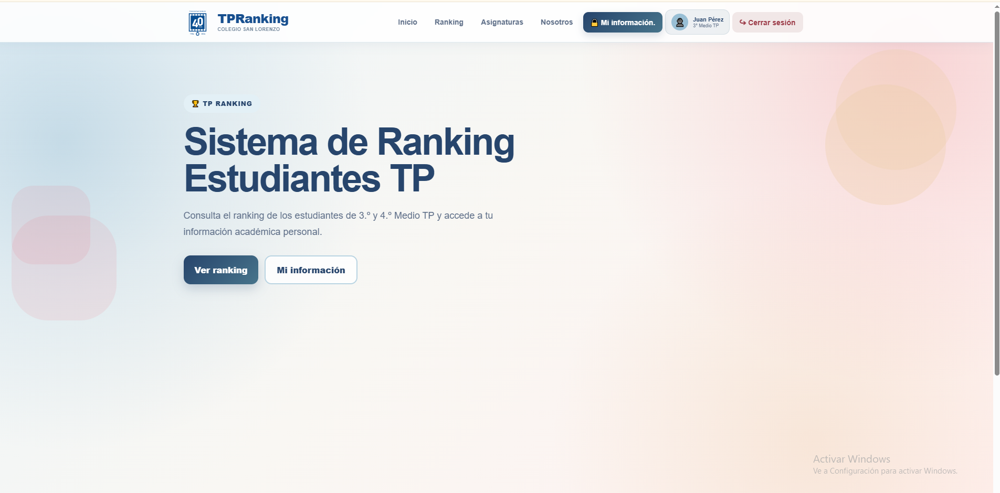

# TP Ranking - Python Flask

Proyecto convertido desde Astro a Python Flask.

## Estructura

```text
seguimiento_ranking/
├── app/
│   ├── __init__.py
│   ├── config.py
│   ├── database.py
│   ├── models.py
│   ├── office.py
│   └── routes.py
├── static/
│   ├── css/style.css
│   ├── js/script.js
│   └── favicon.svg
├── templates/
│   ├── includes/
│   ├── pages/
│   ├── base.html
│   └── index.html
├── app.py
├── requirements.txt
└── tp_ranking.db
```

## Instalar

En la terminal de VS Code:

```bash
python -m pip install -r requirements.txt
```

## Ejecutar

```bash
python app.py
```

Luego abre:

```text
http://127.0.0.1:5000
```

## Usuario de prueba

```text
RUT: 12.345.678-9
Contraseña: 123456
```

Los demás estudiantes de demostración usan la contraseña:

```text
123456
```

## Importante

No se utiliza JavaScript para el calendario. El cambio entre los 12 meses se realiza con
radio buttons de HTML y CSS.

Las rutas están centralizadas en `app/routes.py`. No se deben volver a declarar en `app.py`.

La información privada solamente se carga en `/mi-informacion` para el estudiante que inició sesión.
La página `/ranking` muestra únicamente nombre y posición.


# TP Ranking

## 📌 Nombre y descripción del proyecto

**TP Ranking** es una aplicación web desarrollada para facilitar el seguimiento académico de estudiantes de **3.º y 4.º Medio Técnico Profesional (TP)**.

El proyecto busca solucionar el proceso manual que actualmente realiza la profesora para organizar y mostrar información académica. La aplicación permite consultar el ranking de los estudiantes y, de manera privada, revisar información personal como notas, promedio, asistencia y anotaciones.

El sistema separa la información de los cursos de 3.º y 4.º Medio TP y protege los datos personales de cada estudiante.

---

## 🛠️ Tecnologías utilizadas

- **Python**
- **Flask** — Framework utilizado para desarrollar la aplicación web.
- **Jinja2** — Sistema de plantillas utilizado para generar las páginas HTML.
- **SQLite** — Base de datos utilizada para almacenar la información.
- **HTML5** — Estructura de las páginas.
- **CSS3** — Diseño y estilos de la aplicación.
- **Git y GitHub** — Control de versiones y almacenamiento del proyecto.
- **Visual Studio Code** — Editor utilizado durante el desarrollo.

---

## ⚙️ Instalación y despliegue

### 1. Clonar el repositorio

```bash
git clone URL_DEL_REPOSITORIO
```

Luego ingresar a la carpeta:

```bash
cd seguimiento_ranking
```

### 2. Instalar las dependencias

Ejecutar:

```bash
python -m pip install -r requirements.txt
```

### 3. Ejecutar la aplicación

Ejecutar:

```bash
python run.py
```

Flask iniciará el servidor local.

Luego abrir en el navegador:

```text
http://127.0.0.1:5000
```

---

## 🌐 Rutas del proyecto

| Ruta | Funcionalidad |
|---|---|
| `/` | Página de inicio de sesión. |
| `/login` | Permite a los estudiantes iniciar sesión. |
| `/logout` | Cierra la sesión del usuario. |
| `/rankingtp` | Página principal del sistema después de iniciar sesión. |
| `/ranking` | Muestra el ranking de estudiantes de 3.º y 4.º Medio TP. |
| `/asignaturas` | Muestra las asignaturas consideradas en el seguimiento académico. |
| `/nosotros` | Presenta información y objetivos del proyecto. |
| `/mi-informacion` | Muestra la información privada del estudiante que inició sesión. |

Las rutas que contienen información de estudiantes están protegidas mediante una validación de sesión para impedir el acceso de usuarios no autenticados.

---

## 📁 Estructura del proyecto

```text
seguimiento_ranking/
│
├── run.py
├── requirements.txt
├── README.md
├── .env
├── .gitignore
│
├── app/
│   ├── __init__.py
│   ├── config.py
│   ├── databases.py
│   ├── models.py
│   ├── office.py
│   └── routes.py
│
├── static/
│   ├── css/
│   │   └── style.css
│   ├── js/
│   │   └── script.js
│   └── images/
│
└── templates/
    ├── base.html
    │
    ├── includes/
    │   ├── header.html
    │   ├── footer.html
    │   └── tarjeta-taller.html
    │
    └── pages/
        ├── login.html
        ├── rankingtp.html
        ├── ranking.html
        ├── asignaturas.html
        ├── nosotros.html
        └── mi-informacion.html
```

### Organización principal

- `run.py`: inicia la aplicación Flask.
- `app/`: contiene la lógica principal del sistema.
- `routes.py`: define las rutas y conecta las páginas con el backend.
- `models.py`: contiene las consultas y funciones relacionadas con los datos.
- `databases.py`: configura y crea las tablas de SQLite.
- `office.py`: incorpora datos iniciales de prueba.
- `templates/`: contiene las páginas HTML y las plantillas Jinja2.
- `static/css/`: contiene los estilos visuales.
- `static/js/`: contiene el JavaScript del proyecto.
- `static/images/`: almacena las imágenes utilizadas por la aplicación.
- `README.md`: documentación del proyecto.

---

## 🗄️ Base de datos

La aplicación utiliza **SQLite** para almacenar y organizar la información académica.

La base de datos contiene las siguientes tablas:

### `students`

Almacena la información básica de los estudiantes:

- ID
- RUT
- Nombre
- Curso
- Contraseña en formato seguro

### `grades`

Almacena las calificaciones de cada estudiante:

- ID
- ID del estudiante
- Asignatura
- Nota

Las asignaturas consideradas son:

- Infraestructura TI
- Diseño de Base de Datos
- Programación y Algoritmos
- Desarrollo Web

### `annotations`

Almacena las anotaciones personales de cada estudiante:

- ID
- ID del estudiante
- Título
- Contenido

### `attendance`

Almacena la asistencia:

- ID
- ID del estudiante
- Fecha
- Estado de asistencia

La información de las tablas se relaciona mediante el ID del estudiante. De esta manera, cada estudiante puede consultar solamente su información personal cuando inicia sesión.

---

## ✨ Funcionalidades principales

- 🔐 Inicio de sesión mediante RUT y contraseña.
- 👤 Sesiones de usuario.
- 🏆 Ranking separado para 3.º y 4.º Medio TP.
- 📊 Cálculo y visualización del promedio.
- 📚 Visualización de las asignaturas.
- 🔒 Protección de la información personal.
- 📝 Visualización de anotaciones personales.
- 📅 Calendario de asistencia durante todo el año.
- 🟢 Registro de asistencia presente.
- 🟡 Registro de asistencia parcial.
- 🔴 Registro de inasistencia.
- 🚪 Cierre de sesión.
- 🎨 Interfaz visual desarrollada con HTML y CSS.
- 📱 Diseño adaptable a diferentes tamaños de pantalla.

---

## 🔒 Privacidad de la información

Una de las características principales del proyecto es la separación entre la información pública y privada.

En el **ranking general** solamente se muestra:

- Posición.
- Nombre del estudiante.

No se muestran las notas, anotaciones, asistencia ni otros datos personales de los demás estudiantes.

En **"Mi información"**, cada estudiante puede consultar solamente sus propios:

- Datos personales.
- Posición en el ranking.
- Promedio.
- Notas.
- Asistencia.
- Anotaciones.

---

## 👥 Integrantes

- **[Nombre completo del integrante 1]**
- **[Nombre completo del integrante 2]**
- **[Nombre completo del integrante 3]**
- **[Nombre completo del integrante 4]**

> Reemplazar esta sección con los nombres completos de los integrantes del equipo.

---

## 🖥️ Captura de pantalla

A continuación se debe incluir una captura de pantalla de la página principal de la aplicación funcionando en Flask.

Guarda la imagen dentro de:

```text
static/images/
```

Por ejemplo:

```text
static/images/pagina-principal.png
```

Luego agrega la imagen aquí:



---

## 📌 Estado del proyecto

Proyecto académico desarrollado para facilitar el seguimiento y consulta del ranking de estudiantes de 3.º y 4.º Medio TP mediante una aplicación web desarrollada con Flask.

